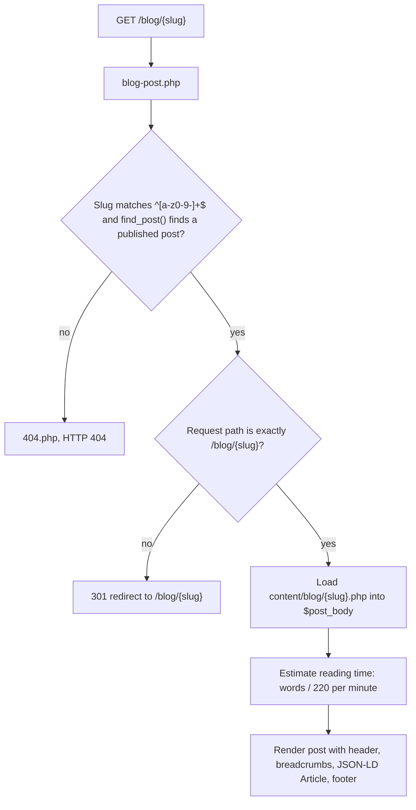

# Architecture

mrpythonist.com is a no-framework PHP site. There is no router library, no
template engine, no ORM, and no database. Every request is handled by a plain
PHP file that includes shared pieces and prints HTML.

## Request flow

On the live host (Apache/LiteSpeed), rewrite rules map clean URLs to PHP
files. Locally, `router.php` does the same job for the PHP built-in server.
Both paths end at the same page files.

```mermaid
flowchart TD
    V[Visitor] --> S[Web server]
    S --> R{URL matches a route?}
    R -->|"/" , "/projects" , "/contact" , ...| P[Page file: index.php, projects.php, contact.php]
    R -->|"/blog/{slug}"| B[blog-post.php]
    R -->|"/projects/{slug}"| PP[project-page.php]
    R -->|"/tech-stack/{slug}"| T[tech-page.php]
    R -->|no match| N[404.php with HTTP 404]
    P --> H[includes/header.php]
    P --> D[data/*.php]
    P --> F[includes/footer.php]
    B --> D
    PP --> D
    T --> D
    H --> C[includes/config.php]
    H --> SEO[includes/seo.php]
```

### How a page renders

1. The page file sets a `$page` array: title, description, canonical path, and
   optional Open Graph and JSON-LD data.
2. It requires `includes/header.php`, which requires `includes/config.php`
   and `includes/seo.php`, prints the `<head>` (title, meta, canonical,
   Open Graph, JSON-LD), and prints the navigation.
3. It prints its own content, usually by requiring section files from
   `includes/` (hero, projects section, tech stack, experience, about,
   contact section) or by looping over data arrays from `data/`.
4. It requires `includes/footer.php`.

The home page (`index.php`) is the clearest example: it requires the data
file, then header, hero, projects section, tech stack, experience, about,
contact section, and footer, in that order.

## Data layer

Content lives in PHP arrays, not a database:

| File | Contents |
| --- | --- |
| `data/portfolio.php` | 3 projects, tech stack summary, experience entries |
| `data/tech.php` | 15 technology detail pages, each with an honest experience level |
| `data/project-details.php` | Longer content for the 3 project detail pages |
| `data/blog.php` | Blog post metadata: slug, title, date, description, tags, status |

Two rules hold across all data files:

- Direct web access is denied by the `.htaccess` in each directory, and the
  data files themselves return 404 if executed directly as scripts.
- Data files only describe content. They never talk to a database, an API,
  or the filesystem outside their own include.

## Blog dispatch



- `blog.php` lists published posts only. A post with `status => 'draft'`
  in `data/blog.php` appears nowhere: not in the index, not in the sitemap,
  and `find_post()` will not return it, so its URL 404s.
- `blog-post.php` also handles the legacy query-string URL
  (`/blog-post.php?slug=x`) with a 301 to the clean URL.
- The sitemap is static. Adding a post requires a manual `sitemap.xml`
  entry; nothing generates it from `data/blog.php`.

## SEO

`includes/seo.php` renders the `<head>` from the `$page` array:

- Title, meta description, canonical URL (built from `SITE_URL` in
  `includes/config.php`, never hardcoded per page).
- Open Graph tags, defaulting to `/assets/images/og-image.png`.
- JSON-LD: Person and WebSite on the home page, WebPage and BreadcrumbList
  elsewhere, ItemList on the blog index, Article data on posts.

`sitemap.xml` is a static file with 39 URLs. `robots.txt` allows `/`,
disallows `/includes/`, `/data/`, and `/content/`, and lists the sitemap.
Search Console verification is by DNS TXT record, so no verification token
is committed.

## Contact

`contact.php` is the only page with server-side form handling:

- On POST it checks a CSRF token stored in the session, a honeypot field,
  and a one-submission-per-minute session rate limit.
- It validates name (2-100 chars), email (valid format, max 254 chars),
  and message (10-5000 chars).
- On success it calls PHP `mail()` to `CONTACT_EMAIL` with a stripped
  reply-to address to block header injection. If `mail()` returns false,
  the visitor sees an error, not a false success.
- Delivery depends on the host mail setup. The mailto link in the contact
  section is the fallback.

There is no user accounts system, no session use outside the contact form
CSRF token and rate limit, and no stored data of any kind.

## Assets and caching

- One stylesheet (`assets/css/style.css`), one small script
  (`assets/js/main.js`), system font stack, no webfonts, no third-party
  requests.
- `ASSET_VERSION` in `includes/config.php` is appended to asset URLs as a
  query string (`?v=2`). Bump it when assets change to bust the long-lived
  cache.
- The live host sets long-lived caching for versioned CSS, JS, and images.
  The same intent is in `nginx.conf.example`.

## What is intentionally missing

- No root `.htaccess` in the repo. The live host holds the Apache rewrite
  rules. `router.php` covers local development only.
- No build step, no Composer packages, no Node.js, no database, no admin
  panel, no search.
- No automated sitemap generation and no test suite. Verification is
  `php -l` plus manual route checks (see `docs/development.md`).
